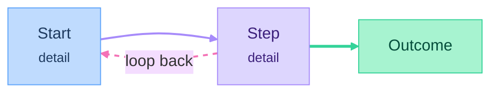

# Product with AI: working conventions

A free Pytopia course on YouTube. See [README.md](README.md) for the syllabus and [course/README.md](course/README.md) for episode conventions.

## Lessons are Claude artifacts

- Each episode's interactive lesson is a Claude artifact. Its HTML source lives in the repo at `course/parts/NN-name/NN-episode-name/lesson.html`.
- After publishing, put the artifact URL in the episode's `notes.md` (the **Lesson artifact** field) and in the part README's episode list.
- `notes.md` is the recording script. `lesson.html` is what students read and interact with.
- Republish from the same file so the artifact keeps its URL.

## Mermaid diagrams in markdown

Use a diagram wherever a flow, a loop, a fork or an architecture is easier to see than to read. Don't add one if the list already says it clearly.

Every diagram uses this template:

````markdown

````

What the colors mean:

| Role | Nodes | Edges |
|---|---|---|
| Entry point | `start` (blue) | — |
| Normal step | `step` (purple) | purple, 2px |
| Outcome or result | `done` (green) | green, 3px, for the edge into the outcome |
| Feedback loop, alternative path, external system | `side` (pink) | pink, 2px, dashed |

Rules:
- Node labels: a short title, then optional detail as `<br/><small>…</small>`.
- Prefer `flowchart LR`; use `TB` only when a left-to-right diagram gets too wide.
- `linkStyle` indices count edges in the order they're written, starting at 0. Recount after adding or removing an edge. Comma lists are fine: `linkStyle 0,1,2 …`.
