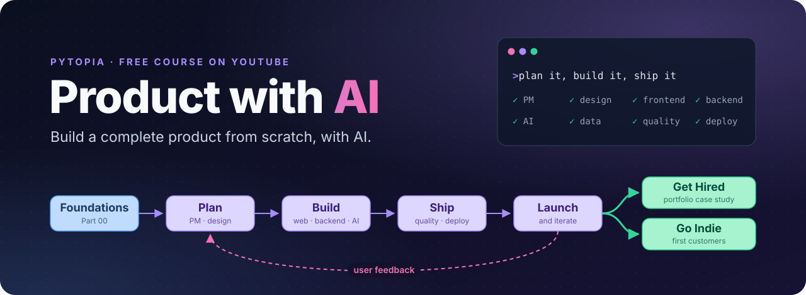
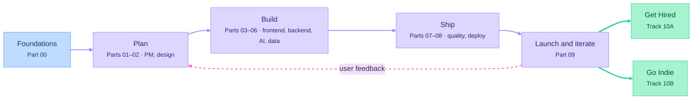

# Product with AI

A free Pytopia course on YouTube about building a complete product from scratch with AI, and covering every role a product needs: product management, design, frontend, backend, AI engineering, data, quality, deployment and launch.

AI coding agents now write much of the code. The skills that matter are deciding what to build, breaking it into tickets, directing the agent, reviewing what it produces, and getting the product in front of real users. This course teaches all of them.

**Start here:** watch the [course kickoff](https://claude.ai/artifact/9bfcm7wScXzEq1BTE9wCxL), then follow the episodes in order from the [course index](course/README.md).

## Who it's for

- You know a little programming: you can read basic Python and you've used a terminal.
- Everything else (web, databases, design, AI, deployment, product management) is taught from scratch.
- You don't need to master every detail. You need to understand each layer well enough to direct an AI agent, review its work and ship.

## What you'll get out of it

Everyone builds a real product of their own alongside the course. At the end, you choose a track:
- **Get Hired:** turn the product into a portfolio piece and prepare for AI-era engineering roles.
- **Go Indie:** turn the product into a business and find your first customers.

## How the course works

- **Self-paced videos**, 5–12 minutes each, in three types:
  - **Concept:** one idea explained on its own, useful outside the course.
  - **Build-along:** we apply it to one of the reference products on screen.
  - **Your Turn:** a short brief for applying it to your own product, as a ticket.
- **An interactive lesson for every video.** Keep it open while you watch: it has the diagrams, the prompts we use and your brief. Find them all in the [course index](course/README.md).
- **Three reference products, and yours:** we build [three products](project/) on camera, each with a different amount of AI, and you build your own idea alongside them.
- **The course is a Linear board.** Every lesson is a ticket you import and close as you go. See [course/linear/](course/linear/).
- **Catch-up points:** each reference product has a git tag at the end of every part it appears in (e.g. `part04-end`), so you can always pick up from there.
- **We review every diff.** If we can't explain AI-written code, we don't merge it.

## Syllabus



| Part | Topic | You finish with |
|---|---|---|
| 00 | [Foundations](course/README.md#part-00-foundations) | A working setup and your first merged pull request |
| 01 | [Product Management](course/README.md#part-01-product-management) | A one-page spec and an MVP backlog |
| 02 | [Design](course/README.md#part-02-design) | A clickable prototype |
| 03 | [Frontend](course/README.md#part-03-frontend) | A UI running on mock data |
| 04 | [Backend and Data](course/README.md#part-04-backend-and-data) | A working full-stack MVP |
| 05 | [AI Engineering](course/README.md#part-05-ai-engineering) | An AI feature with an eval suite |
| 06 | [Data and Analytics](course/README.md#part-06-data-and-analytics) | A metrics dashboard |
| 07 | [Quality and Security](course/README.md#part-07-quality-and-security) | CI with passing tests and a security checklist |
| 08 | [Ship and Operate](course/README.md#part-08-ship-and-operate) | A live product on a custom domain, taking payments |
| 09 | [Launch and Iterate](course/README.md#part-09-launch-and-iterate) | A public launch and one shipped iteration |
| 10 | [Tracks: Get Hired / Go Indie](course/README.md#part-10-tracks) | A portfolio case study, or your first customers |

## Repository layout

```
product-with-ai/
├── course/
│   ├── README.md    # index of every episode, with links to its lesson artifact and video
│   ├── episodes/    # extra files for an episode, only when it needs them
│   └── linear/      # the course as an importable Linear backlog
└── project/         # the three reference products built on camera
```

## Status

Planning: syllabus and repo structure.
