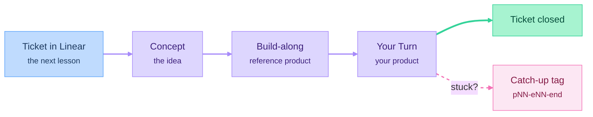

# Course materials

## Structure

- `parts/NN-name/README.md`: the part's outcome, episode list and deliverable.
- `parts/NN-name/NN-episode-name/notes.md`: the script outline for one episode, including the prompts used on camera. Start from [templates/episode-notes.md](templates/episode-notes.md).
- `parts/NN-name/NN-episode-name/lesson.html`: the episode's interactive lesson, published as a Claude artifact. Students follow the video with this page open.
- `linear/`: every lesson as a ticket, for students to import.

## How a lesson works

## Episode types

| Type | What it is | Re-recording |
|---|---|---|
| **Concept** | One idea explained on its own (whiteboard or slides) | Rarely; keep it tool-independent |
| **Build-along** | Applying the idea to the reference product (screencast) | When tools change; keep these short |
| **Your Turn** | A brief and a ticket for the student's own product | Rarely |

## Conventions

- Episode IDs: `pNN-eNN` (e.g. `p04-e03`).
- Build-along episodes have git tags in `project/` for their start and end state: `p04-e03-start` → `p04-e03-end`.
- Every part ends with a catch-up tag: `part04-end`.
- Each lesson's artifact URL goes in its `notes.md` and in the part README's episode list.
- Tool-specific details also go in the episode notes, so small changes can be fixed in writing without re-recording.
- When the AI agent makes a mistake on camera, keep it in the edit and debug it.
