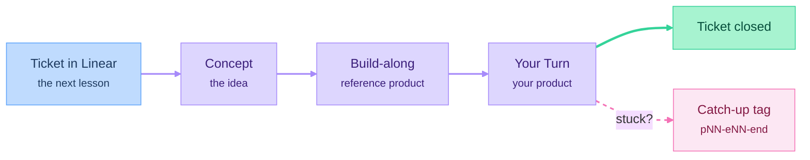
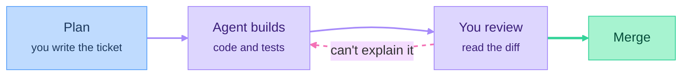
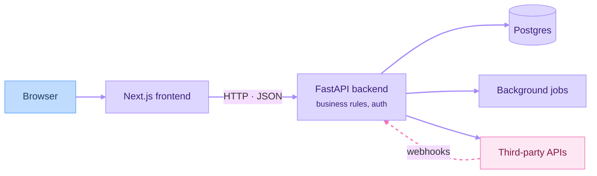
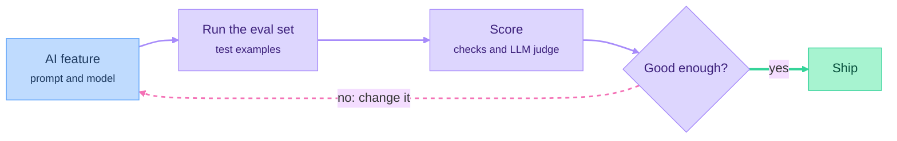
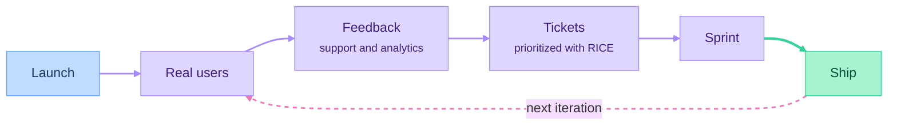
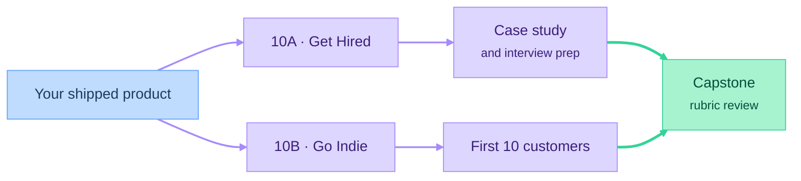

# Course index

Every part and episode of the course, with links to its lesson and video. Each lesson is a Claude artifact: students follow the video with the lesson open.

## How a lesson works

## Episode types

| Type | What it is | Re-recording |
|---|---|---|
| **Concept** | One idea explained on its own (whiteboard or slides) | Rarely; keep it tool-independent |
| **Build-along** | Applying the idea to the reference product (screencast) | When tools change; keep these short |
| **Your Turn** | A brief and a ticket for the student's own product | Rarely |

## What every lesson contains

The lesson is also the recording outline, so there's no separate script.

- **Header:** episode ID, type, target length and Linear ticket. Git tags stay in the repo and are never mentioned in lessons.
- **Goal:** by the end, viewers can …
- **Key takeaways:** three to five.
- **The lesson itself:** sections in recording order, with diagrams and interactive pieces where they help.

Lessons teach. They don't include quizzes, copyable prompt blocks, briefs or checklists. Exercises for the student's own product belong in Your Turn episodes.

## Conventions

- Episode IDs: `pNN-eNN` (e.g. `p04-e03`). Track episodes in Part 10 use `p10a-eNN` and `p10b-eNN`.
- An episode only gets a folder, `course/episodes/pNN-eNN/`, when it needs files beside its lesson (starter code, datasets, images).
- Build-along episodes have git tags in `project/` for their start and end state: `p04-e03-start` → `p04-e03-end`.
- Every part ends with a catch-up tag: `part04-end`.
- Status: `planned` → `drafting` → `published` (lesson artifact shared) → `recorded` (video live).
- Artifacts are private by default. Turn on link sharing before linking one here.
- Tool-specific details go in the lesson, so small changes can be fixed in writing without re-recording.
- When the AI agent makes a mistake on camera, keep it in the edit and debug it.

---

## Part 00: Foundations

*Outcome: your machine is set up, you can read code well enough to review it, and you've merged your first pull request with an AI agent's help.*
*Deliverable: your own repo with a first merged pull request.*

At a glance: the loop you'll use for every change in the course

| ID | Type | Episode | Lesson | Video | Status |
|---|---|---|---|---|---|
| p00-e01 | Concept | How a product works end to end: client, server, database, API, cloud | [Lesson](https://claude.ai/artifact/EUR449wTAHsfjHXAQk7fGD) | | drafting |
| p00-e02 | Build-along | Terminal and files | [Lesson](https://claude.ai/artifact/Aj6q1jTvgs6YAtavWj8bPy) | | drafting |
| p00-e03 | Build-along | Git and GitHub: commits, branches, pull requests | [Lesson](https://claude.ai/artifact/YL31nCSGV8jvvUJuE3igaK) | | drafting |
| p00-e04 | Concept | Code literacy: reading Python and TypeScript (variables, functions, objects, async) | [Lesson](https://claude.ai/artifact/NLS3SEYqo5MqmWuE98KDR4) | | drafting |
| p00-e05 | Concept | Working with AI coding agents: the plan → build → review loop | [Lesson](https://claude.ai/artifact/LzQV7KZbja7SDjCESXJypf) | | drafting |
| p00-e06 | Build-along | Project instructions and context files for your agent | | | planned |
| p00-e07 | Your Turn | Import the course Linear board, create your repo, merge your first pull request | | | planned |

## Part 01: Product Management

*Outcome: you know what you're building, for whom, and the work is broken down into tickets.*
*Deliverable: a one-page spec and a backlog of about 20 tickets.*

```mermaid
%%{init: {'theme': 'base', 'themeVariables': {'background': '#ffffff'}, 'flowchart': {'curve': 'basis'}}}%%
flowchart LR
    I["Idea"] --> U["User interviews<br/><small>is the problem real?</small>"]
    U --> S["One-page spec<br/><small>MVP scope</small>"]
    S --> T["Tickets<br/><small>epics and stories</small>"]
    T --> B["MVP backlog<br/><small>about 20 tickets</small>"]
    U -.->|"problem isn't real"| I

    classDef start fill:#bfdbfe,stroke:#60a5fa,color:#1e3a5f
    classDef step fill:#ddd6fe,stroke:#a78bfa,color:#3b1f7a
    classDef done fill:#a7f3d0,stroke:#34d399,color:#064e3b
    classDef side fill:#fce7f3,stroke:#f472b6,color:#831843

    class I start
    class U,S,T step
    class B done

    linkStyle 0,1,2 stroke:#a78bfa,stroke-width:2px
    linkStyle 3 stroke:#34d399,stroke-width:3px
    linkStyle 4 stroke:#f472b6,stroke-width:2px,stroke-dasharray:5
```

At a glance: from idea to backlog

| ID | Type | Episode | Lesson | Video | Status |
|---|---|---|---|---|---|
| p01-e01 | Concept | What a product is: problem vs. solution | | | planned |
| p01-e02 | Concept | Choosing an idea: portfolio-worthy vs. market-worthy | | | planned |
| p01-e03 | Concept | User interviews, and synthesizing them with AI | | | planned |
| p01-e04 | Build-along | Competitor and market scan | | | planned |
| p01-e05 | Concept | Writing a one-page spec: user stories, MVP scope, what's out of scope | | | planned |
| p01-e06 | Concept | Project management: issues, epics, sprints, estimation, priority, backlog (Linear and Jira) | | | planned |
| p01-e07 | Build-along | Turning the spec into tickets; what a good ticket looks like | | | planned |
| p01-e08 | Your Turn | Write your spec and MVP backlog | | | planned |

## Part 02: Design

*Outcome: you can see and click through the product before writing real code.*
*Deliverable: a clickable prototype.*

| ID | Type | Episode | Lesson | Video | Status |
|---|---|---|---|---|---|
| p02-e01 | Concept | UX fundamentals: user flows, information architecture, the happy path | | | planned |
| p02-e02 | Build-along | Wireframes in Figma or Excalidraw | | | planned |
| p02-e03 | Build-along | AI prototyping (v0, artifacts) | | | planned |
| p02-e04 | Concept | Visual basics: typography, spacing, color, hierarchy | | | planned |
| p02-e05 | Concept | Design systems: Tailwind and shadcn | | | planned |
| p02-e06 | Concept | Accessibility and responsive layout basics | | | planned |
| p02-e07 | Your Turn | Prototype your product's main flow | | | planned |

## Part 03: Frontend

*Outcome: the real UI runs in the browser on mock data.*
*Deliverable: a UI running on mock data, deployed as a preview.*

| ID | Type | Episode | Lesson | Video | Status |
|---|---|---|---|---|---|
| p03-e01 | Concept | How the web works: HTML, CSS, JavaScript, the DOM | | | planned |
| p03-e02 | Concept | React: components, props, state | | | planned |
| p03-e03 | Concept | Next.js: routing, layouts, server vs. client components | | | planned |
| p03-e04 | Build-along | Building the main pages | | | planned |
| p03-e05 | Build-along | Forms, validation, and loading, error and empty states | | | planned |
| p03-e06 | Concept | Calling APIs from the frontend | | | planned |
| p03-e07 | Your Turn | Build your UI on mock data and deploy a preview | | | planned |

## Part 04: Backend and Data

*Outcome: a working full-stack MVP with real data and real users.*
*Deliverable: a working full-stack MVP.*

At a glance: how the pieces connect by the end of this part

| ID | Type | Episode | Lesson | Video | Status |
|---|---|---|---|---|---|
| p04-e01 | Concept | APIs: HTTP, REST, status codes, designing endpoints | | | planned |
| p04-e02 | Build-along | FastAPI essentials | | | planned |
| p04-e03 | Concept | Databases: data modeling, SQL basics, Postgres | | | planned |
| p04-e04 | Build-along | Schema, ORM and migrations | | | planned |
| p04-e05 | Concept | Authentication and authorization | | | planned |
| p04-e06 | Build-along | Sign-in and roles | | | planned |
| p04-e07 | Concept | Background jobs, webhooks and file storage | | | planned |
| p04-e08 | Build-along | Integrating third-party APIs | | | planned |
| p04-e09 | Your Turn | Connect your frontend to a real backend | | | planned |

## Part 05: AI Engineering

*Outcome: the product has an AI feature that users can rely on, and you can measure how good it is.*
*Deliverable: an AI feature with an eval suite.*

At a glance: no AI change ships without going through the eval loop

| ID | Type | Episode | Lesson | Video | Status |
|---|---|---|---|---|---|
| p05-e01 | Concept | How LLMs work for app developers: tokens, context windows, sampling | | | planned |
| p05-e02 | Build-along | Calling an LLM API: prompts and system prompts | | | planned |
| p05-e03 | Concept | Structured outputs and tool use | | | planned |
| p05-e04 | Concept | RAG: embeddings, vector search (pgvector), chunking | | | planned |
| p05-e05 | Concept | Agents: the agent loop, MCP, agent SDKs, and when not to use an agent | | | planned |
| p05-e06 | Concept | Evals: test datasets and LLM-as-judge | | | planned |
| p05-e07 | Build-along | An eval suite for the AI feature | | | planned |
| p05-e08 | Concept | Production concerns: cost, latency, caching, streaming, guardrails | | | planned |
| p05-e09 | Concept | When classical ML or a simple heuristic beats an LLM | | | planned |
| p05-e10 | Your Turn | Add one AI feature to your product, with evals | | | planned |

## Part 06: Data and Analytics

*Outcome: you know how people use the product, and you can show it on a dashboard.*
*Deliverable: a metrics dashboard.*

| ID | Type | Episode | Lesson | Video | Status |
|---|---|---|---|---|---|
| p06-e01 | Concept | Data processing and pipelines: pandas, polars, ETL | | | planned |
| p06-e02 | Concept | Product analytics: events, funnels, retention | | | planned |
| p06-e03 | Build-along | Event tracking with PostHog | | | planned |
| p06-e04 | Concept | Data visualization: choosing the right chart | | | planned |
| p06-e05 | Build-along | Building a metrics dashboard | | | planned |
| p06-e06 | Concept | A/B tests and feature flags | | | planned |
| p06-e07 | Your Turn | Track your core metrics | | | planned |

## Part 07: Quality and Security

*Outcome: you can trust the code, including the code the AI wrote.*
*Deliverable: CI with passing tests, and a completed security checklist.*

| ID | Type | Episode | Lesson | Video | Status |
|---|---|---|---|---|---|
| p07-e01 | Concept | Testing: unit, integration and end-to-end (pytest, Playwright) | | | planned |
| p07-e02 | Build-along | Having AI write tests, then reviewing the tests | | | planned |
| p07-e03 | Concept | Reviewing AI-written pull requests: a checklist | | | planned |
| p07-e04 | Build-along | "The AI got it wrong" labs: debugging plausible-looking broken code | | | planned |
| p07-e05 | Concept | Security: OWASP basics, secrets, auth bugs, prompt injection, dependencies | | | planned |
| p07-e06 | Your Turn | Add CI and complete the security checklist | | | planned |

## Part 08: Ship and Operate

*Outcome: the product is live, monitored, and can take payments.*
*Deliverable: a live product on a custom domain, taking payments (test mode is fine).*

| ID | Type | Episode | Lesson | Video | Status |
|---|---|---|---|---|---|
| p08-e01 | Concept | Environments, environment variables and secrets; Docker basics | | | planned |
| p08-e02 | Build-along | Deploying the frontend and backend | | | planned |
| p08-e03 | Concept | CI/CD with GitHub Actions | | | planned |
| p08-e04 | Concept | Domains, DNS and HTTPS | | | planned |
| p08-e05 | Build-along | Monitoring: logs, error tracking, alerts | | | planned |
| p08-e06 | Build-along | Payments with Stripe; transactional email | | | planned |
| p08-e07 | Concept | Legal basics: terms of service, privacy policy, GDPR | | | planned |
| p08-e08 | Your Turn | Ship your product on a custom domain | | | planned |

## Part 09: Launch and Iterate

*Outcome: real people use the product, and you improve it based on what they say.*
*Deliverable: a public launch and one shipped iteration.*

At a glance: the iteration loop after launch

| ID | Type | Episode | Lesson | Video | Status |
|---|---|---|---|---|---|
| p09-e01 | Concept | Positioning and landing page copy | | | planned |
| p09-e02 | Concept | Pricing | | | planned |
| p09-e03 | Concept | Launch channels: Product Hunt, communities, content, SEO basics | | | planned |
| p09-e04 | Build-along | Collecting feedback and support requests | | | planned |
| p09-e05 | Concept | Prioritization and roadmapping (RICE) | | | planned |
| p09-e06 | Build-along | Feedback → tickets → sprint → ship | | | planned |
| p09-e07 | Your Turn | Launch publicly and ship one iteration | | | planned |

## Part 10: Tracks

Pick the track that matches your goal, or watch both. Episode types for the tracks are still to be decided.

At a glance: two tracks, one capstone

### 10A: Get Hired

*Outcome: your product is a portfolio piece, and you're ready for interviews.*

| ID | Type | Episode | Lesson | Video | Status |
|---|---|---|---|---|---|
| p10a-e01 | | Writing a case study of your product | | | planned |
| p10a-e02 | | Recording a demo video | | | planned |
| p10a-e03 | | A GitHub profile that shows how you work | | | planned |
| p10a-e04 | | A resume for AI-era roles: AI engineer, product engineer, founding engineer | | | planned |
| p10a-e05 | | Interviews: coding with and without AI, take-home projects, light system design, product sense | | | planned |
| p10a-e06 | | Freelancing as a bridge into work | | | planned |

### 10B: Go Indie

*Outcome: your product has its first paying customers.*

| ID | Type | Episode | Lesson | Video | Status |
|---|---|---|---|---|---|
| p10b-e01 | | Finding the first 10 customers | | | planned |
| p10b-e02 | | Sales basics | | | planned |
| p10b-e03 | | Customer support | | | planned |
| p10b-e04 | | Unit economics | | | planned |
| p10b-e05 | | Legal entity basics | | | planned |
| p10b-e06 | | Bootstrapping vs. raising money | | | planned |

### Capstone

A live product and a case study, assessed against a published rubric: it works, spec quality, ticket hygiene, tests and evals, security checklist, and the write-up.
