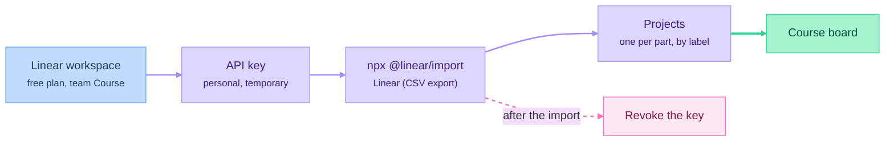

# The course as a Linear backlog

Students import this backlog into their own Linear workspace (free plan) and work through the course by closing tickets. That way they practice product management while taking the course. The import is walked through on camera in p00-e07.

## What's in it

[`backlog.csv`](backlog.csv) has one issue per episode, plus one for the capstone: 89 issues. It uses the columns of Linear's own CSV export.

| Column | What it holds |
|---|---|
| Title | `pNN-eNN · Episode title`, so issues sort in course order |
| Description | A ticket in the course format: **Why**, **What**, **Done when**, and **Out of scope** for Your Turn episodes |
| Status | `Todo` for Part 00, `Backlog` for everything else |
| Priority | `No priority` |
| Labels | The episode type (`Concept`, `Build-along`, `Your Turn`) and the part (`Part 00` … `Part 10B`). Track episodes and the capstone have no type label yet. |
| Project | The project the issue belongs in, one per part: `Part 00: Foundations` and so on |

The course uses 89 of the free plan's 250 issues, which leaves room for the student's own product backlog.

## Import it



1. **Workspace and team.** Create a free Linear workspace. It comes with one team: rename it `Course` and set its identifier to `CRS` (Settings → Teams). The free plan allows two teams. The second one is for the student's own product.
2. **Node.js 20.19 or newer.** Linear's importer runs on Node. Check with `node --version`. If it's missing or older, install the LTS version from nodejs.org (macOS: `brew install node`). Part 03 needs Node anyway.
3. **API key.** In Linear, Settings → Account → Security & access → Personal API keys → New key. It's a password for your workspace: never paste it into a file or a ticket.
4. **Download the CSV and run the importer:**

   ```bash
   curl -LO https://raw.githubusercontent.com/hejazizo/product-with-ai/main/course/linear/backlog.csv
   ```

   ```bash
   npx @linear/import
   ```

   Answer the prompts: paste the API key, choose **Linear (CSV export)**, select `backlog.csv`, answer **No** to creating a new team and choose `Course`, and answer **Yes** to assigning the issues to yourself.
5. **Revoke the key** in the same settings page once the import finishes.
6. **One project per part.** The importer ignores the Project column, so group the issues by hand: create a project named after each part (`Part 00: Foundations`, …), then in the team's issue list filter by the part's label, select all (<kbd>Cmd</kbd>/<kbd>Ctrl</kbd>+<kbd>A</kbd>) and set the project (<kbd>Shift</kbd>+<kbd>P</kbd>).

Run the importer once. Running it again creates every issue a second time, so if an import fails halfway, delete the issues it made before you retry.

Importer details, for when something changes: Linear's CLI importer lives in [linear/linear, `packages/import`](https://github.com/linear/linear/tree/master/packages/import). Its Linear CSV importer reads Title, Description, Status, Priority, Labels, Estimate, Assignee and the date columns, and splits labels on `, `. A status that doesn't exist in the team is created as a new one.

## Jira

Jira's CSV importer can map the same file. Map Title to Summary, Description to Description and Labels to Labels. Jira labels can't contain spaces, so `Part 00` arrives as two labels unless you replace the space first. Use Jira's own epics in place of Linear projects: one epic per part.

## Editing the backlog

The CSV is the source of truth for the board. When an episode is added, renamed or moved in [the course index](../README.md), change its row here in the same commit. Keep every description in the ticket format above, because students read these tickets as examples of what a good ticket looks like.
