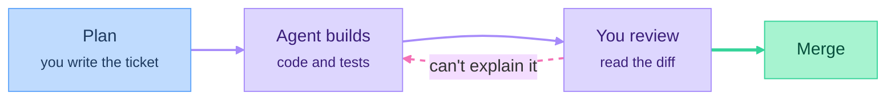

# Part 00: Foundations

*Outcome: your machine is set up, you can read code well enough to review it, and you've merged your first pull request with an AI agent's help.*

## At a glance

The loop you'll use for every change in the course:

## Planned episodes
- [Concept] How a product works end to end: client, server, database, API, cloud
- [Build-along] Terminal and files
- [Build-along] Git and GitHub: commits, branches, pull requests
- [Concept] Code literacy: reading Python and TypeScript (variables, functions, objects, async)
- [Concept] Working with AI coding agents: the plan → build → review loop
- [Build-along] Project instructions and context files for your agent
- [Your Turn] Import the course Linear board, create your repo, merge your first pull request

## Deliverable
Your own repo with a first merged pull request.
