# Part 01: Product Management

*Outcome: you know what you're building, for whom, and the work is broken down into tickets.*

## At a glance

```mermaid
%%{init: {'theme': 'base', 'themeVariables': {'background': '#ffffff'}, 'flowchart': {'curve': 'basis'}}}%%
flowchart LR
    I["Idea"] --> U["User interviews<br/><small>is the problem real?</small>"]
    U --> S["One-page spec<br/><small>MVP scope</small>"]
    S --> T["Tickets<br/><small>epics and stories</small>"]
    T --> B["MVP backlog<br/><small>about 20 tickets</small>"]
    U -.->|"problem isn't real"| I

    classDef start fill:#bfdbfe,stroke:#60a5fa,color:#1e3a5f
    classDef step fill:#ddd6fe,stroke:#a78bfa,color:#3b1f7a
    classDef done fill:#a7f3d0,stroke:#34d399,color:#064e3b
    classDef side fill:#fce7f3,stroke:#f472b6,color:#831843

    class I start
    class U,S,T step
    class B done

    linkStyle 0,1,2 stroke:#a78bfa,stroke-width:2px
    linkStyle 3 stroke:#34d399,stroke-width:3px
    linkStyle 4 stroke:#f472b6,stroke-width:2px,stroke-dasharray:5
```

## Planned episodes
- [Concept] What a product is: problem vs. solution
- [Concept] Choosing an idea: portfolio-worthy vs. market-worthy
- [Concept] User interviews, and synthesizing them with AI
- [Build-along] Competitor and market scan
- [Concept] Writing a one-page spec: user stories, MVP scope, what's out of scope
- [Concept] Project management: issues, epics, sprints, estimation, priority, backlog (Linear and Jira)
- [Build-along] Turning the spec into tickets; what a good ticket looks like
- [Your Turn] Write your spec and MVP backlog

## Deliverable
A one-page spec and a backlog of about 20 tickets.
