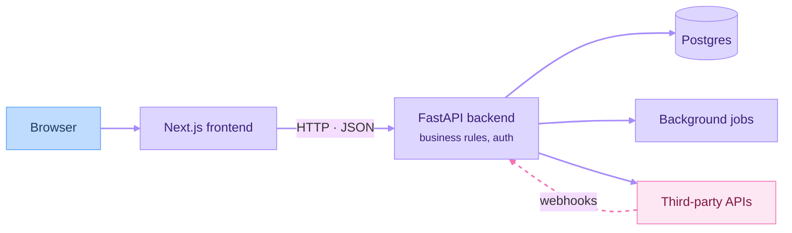

# Part 04: Backend and Data

*Outcome: a working full-stack MVP with real data and real users.*

## At a glance

How the pieces connect by the end of this part:

## Planned episodes
- [Concept] APIs: HTTP, REST, status codes, designing endpoints
- [Build-along] FastAPI essentials
- [Concept] Databases: data modeling, SQL basics, Postgres
- [Build-along] Schema, ORM and migrations
- [Concept] Authentication and authorization
- [Build-along] Sign-in and roles
- [Concept] Background jobs, webhooks and file storage
- [Build-along] Integrating third-party APIs
- [Your Turn] Connect your frontend to a real backend

## Deliverable
A working full-stack MVP.
