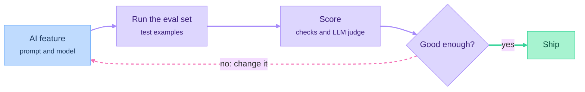

# Part 05: AI Engineering

*Outcome: the product has an AI feature that users can rely on, and you can measure how good it is.*

## At a glance

No AI change ships without going through the eval loop:

## Planned episodes
- [Concept] How LLMs work for app developers: tokens, context windows, sampling
- [Build-along] Calling an LLM API: prompts and system prompts
- [Concept] Structured outputs and tool use
- [Concept] RAG: embeddings, vector search (pgvector), chunking
- [Concept] Agents: the agent loop, MCP, agent SDKs, and when not to use an agent
- [Concept] Evals: test datasets and LLM-as-judge
- [Build-along] An eval suite for the AI feature
- [Concept] Production concerns: cost, latency, caching, streaming, guardrails
- [Concept] When classical ML or a simple heuristic beats an LLM
- [Your Turn] Add one AI feature to your product, with evals

## Deliverable
An AI feature with an eval suite.
