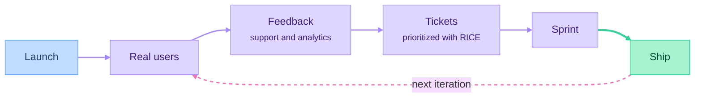

# Part 09: Launch and Iterate

*Outcome: real people use the product, and you improve it based on what they say.*

## At a glance

## Planned episodes
- [Concept] Positioning and landing page copy
- [Concept] Pricing
- [Concept] Launch channels: Product Hunt, communities, content, SEO basics
- [Build-along] Collecting feedback and support requests
- [Concept] Prioritization and roadmapping (RICE)
- [Build-along] Feedback → tickets → sprint → ship
- [Your Turn] Launch publicly and ship one iteration

## Deliverable
A public launch and one shipped iteration.
