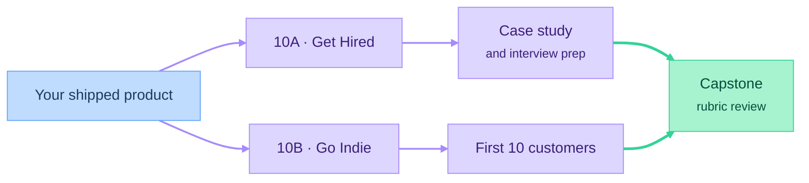

# Part 10: Tracks

Pick the track that matches your goal, or watch both.

## At a glance

## 10A: Get Hired
*Outcome: your product is a portfolio piece, and you're ready for interviews.*
- Writing a case study of your product
- Recording a demo video
- A GitHub profile that shows how you work
- A resume for AI-era roles: AI engineer, product engineer, founding engineer
- Interviews: coding with and without AI, take-home projects, light system design, product sense
- Freelancing as a bridge into work

## 10B: Go Indie
*Outcome: your product has its first paying customers.*
- Finding the first 10 customers
- Sales basics
- Customer support
- Unit economics
- Legal entity basics
- Bootstrapping vs. raising money

## Capstone
A live product and a case study, assessed against a published rubric: it works, spec quality, ticket hygiene, tests and evals, security checklist, and the write-up.
